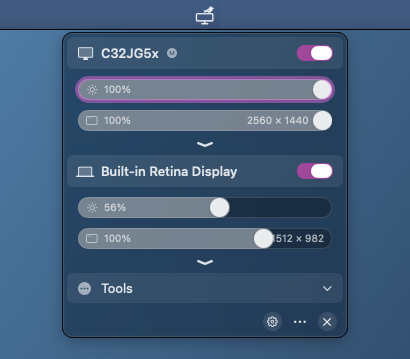

# Screenfinch

Screenfinch is a free Mac menu bar app from Good Tools. Click the finch to adjust brightness, change resolution or choose a refresh rate for each display. Screenfinch runs locally.

## Install

[Download Screenfinch 1.0 for Mac](https://github.com/MadeByGoodTools/Screenfinch-Updates/releases/download/v1.0/GoodTools-Installer-Screenfinch-1.0-macOS-Universal.dmg)

Open the Screenfinch disk image, drag **Screenfinch** onto **Applications**, and launch it there. The same disk image also includes the guided Good Tools Installer. Version 1.0 supports Apple silicon and Intel Macs running macOS 13 or later.

This release is ad-hoc signed and has not been notarized by Apple. Good Tools provides a first-time installation guide. [Installation guide](https://goodtools.ca/first-time-install)

## Open the menu

Open **Screenfinch.app** and click the finch perched on a monitor in the menu bar. A second click closes it. Click the chevron beneath a display to see its controls. The gear opens Settings. Right-clicking the menu-bar icon also opens Settings.

Brightness controls identify their route in the tooltip. Supported displays use the Apple backlight service or DDC/CI. The fallback is a click-through software shade with a 5% minimum. External contrast, audio volume and selectable inputs depend on the monitor and connection.

**Display Mode** includes resolution and refresh-rate selection, saved favorites, and additional native HiDPI timings when macOS reports them. Mode, mirror, arrangement and rotation changes have a 15-second confirmation window. **Keep** confirms the current session's configuration. **Revert** restores the preceding one.

## Virtual screens and local streaming

Choose **Tools → Create Virtual Screen** and enter the logical width and height. HiDPI doubles each backing dimension. Choose **Extend desktop** or a physical monitor to mirror onto. Virtual screens run at 60 Hz. Settings retains their configurations and offers optional reconnection at launch.

Choose **Picture in Picture** or **Stream Display** to show a screen locally. macOS may request Screen Recording permission the first time. The video window’s ellipsis menu offers fit, fill, rotation, flip, zoom and pan. Closing the window stops that stream.

## Display profiles

**Display Information** can export the monitor's EDID when it can be read and validated. **Settings → Displays → [display] → Export Display Override** creates a model-specific profile inside a folder you select. You can include custom scaled modes, an optional display name and a matching replacement EDID. A file export alone does not activate a system override. Support for installing overrides varies by macOS version and connection.

## Build

The release targets Apple silicon and Intel on macOS 13 or later. Build on a Mac with Apple's Command Line Tools or Xcode, a Swift 5.9-compatible or later compiler, and a current macOS SDK.

    ./build.sh
    open 'build/Screenfinch.app'

The script produces a locally ad-hoc-signed universal app. Pass a directory as the first argument to choose its location. The executable also supports read-only display inventory.

    'build/Screenfinch.app/Contents/MacOS/Screenfinch' --list-displays

To run the isolated menu-button regression check, use a separate build directory.

    SCREENFINCH_ARCHS="$(uname -m)" SCREENFINCH_MENU_TEST=1 ./build.sh build-menu-test
    'build-menu-test/Screenfinch.app/Contents/MacOS/Screenfinch' --verify-menu

The test build has its own bundle identifier. The release contains the ordinary app entry point.

To reproduce the Good Tools disk image, install dmgbuild 1.6.5 in a Python environment and make its executable available on your PATH. The packaging script uses Apple's pkgbuild, productbuild and hdiutil along with the included Good Tools artwork.

    Packaging/package.sh build/Screenfinch.app build

To regenerate the menu-bar template and Finder icon from the finch artwork, run this from the source directory.

    xcrun swift Resources/MakeIcon.swift Resources

## Implementation references

Screenfinch uses Quartz Display Services for display configuration and ScreenCaptureKit for local video. Its optional hardware controls are checked at runtime. [Quartz Display Services](https://developer.apple.com/documentation/CoreGraphics/quartz-display-services) · [ScreenCaptureKit](https://developer.apple.com/documentation/ScreenCaptureKit)

Public references used during development include BetterDisplay’s 2.0.11 interface, Chromium’s macOS virtual display implementation and m1ddc’s monitor communication code. [BetterDisplay interface](https://github.com/waydabber/BetterDisplay/blob/e65a24566d829d6f308138727b835830365912eb/README.md) · [Chromium virtual displays](https://chromium.googlesource.com/chromium/src/+/HEAD/ui/display/mac/test/virtual_display_util_mac.mm) · [m1ddc](https://github.com/waydabber/m1ddc)
